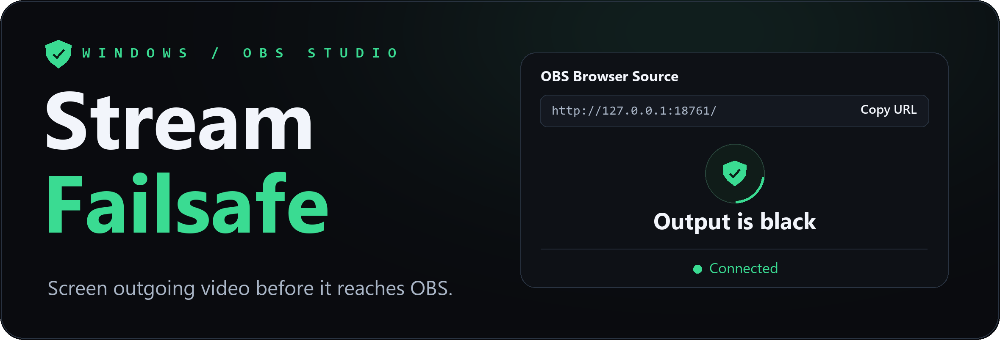

  

  

  
  
  

Stream Failsafe checks outgoing display frames for nudity, sexual content, and graphic imagery on your Windows PC. When it detects content, it withholds the frame and blacks out the OBS source until you re-arm it. [Release notes](https://github.com/bigouncereal2-jpg/no-nsfw-livestream/releases/latest)

## Quick start

1. **Open the app.** Extract the Windows ZIP, launch `Stream Failsafe.exe`, and select **OBS setup** for the walkthrough.
2. **Connect OBS.** Click **Copy URL**. In a fresh OBS scene, paste it into a Browser Source with dimensions matching your canvas. Add a full-canvas black Color Source below it. Remove direct display, window, or game captures of the same content, including from nested scenes. The app shows **Connected** when the Browser Source opens the feed.
3. **Arm and test.** Choose your display and click **Arm protection**. Make a local recording and check normal video, **Test blackout**, and the **Ctrl+Shift+F10** panic hotkey. Click **Arm protection** again when ready to resume. Disable the OBS preview or move it to another monitor if it appears in capture.

## Go live

| Platform | Video setup |
| --- | --- |
| **Twitch** | Stream the protected scene using your normal OBS stream settings. |
| **TikTok LIVE** | Select **OBS Virtual Camera** where your account offers it and add audio in TikTok. With RTMP access, OBS can stream the protected scene directly. [OBS Virtual Camera guide](https://obsproject.com/kb/virtual-camera-guide) |

## What the filter covers

- **Visuals from the selected display.** The filter checks those frames before sending them to OBS. Audio and separate sources in OBS are outside its coverage.
- **Automatic and manual blackout.** A detection or a capture stall turns the output black. Use **Black out** or **Ctrl+Shift+F10** any time protection is active.
- **Timing and accuracy.** Capture runs at up to 30 fps on supported hardware. Classifiers can miss content or flag harmless images. A 1 ms response is beyond this setup.

Connection, arming, and blackout were verified in offline OBS. TikTok account routing remains untested.

## Build from source

Run `Build.ps1` on Windows with Python 3.12. The script uses an isolated environment, verifies both model checksums, and writes `dist/Stream Failsafe.exe`.

Maintained by [bigouncereal2-jpg](https://github.com/bigouncereal2-jpg). [AGPL-3.0 license](LICENSE) · [Model licenses](Models.txt) · [Platform icons by Simple Icons](https://github.com/simple-icons/simple-icons/tree/16.38.0)
